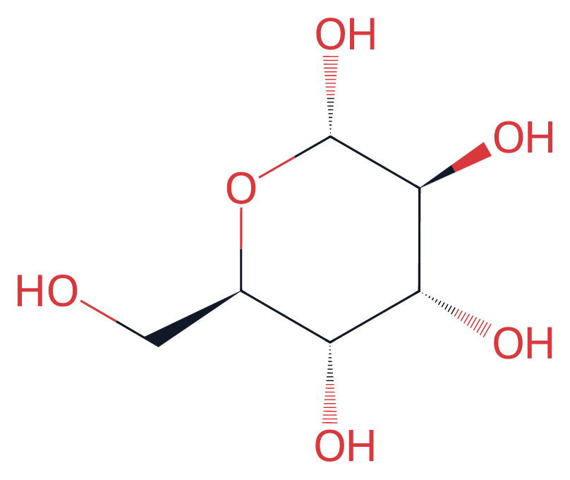
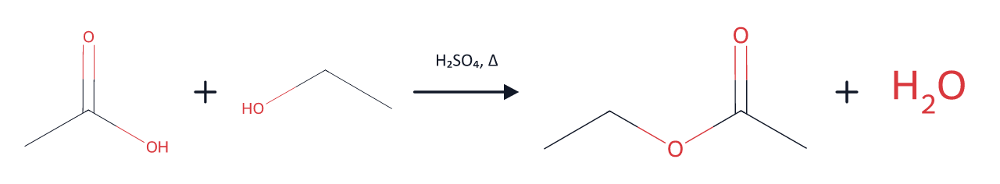
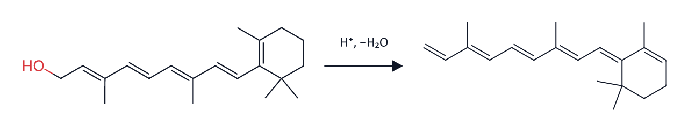
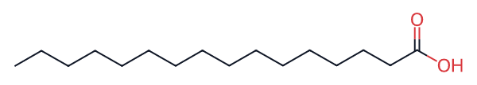
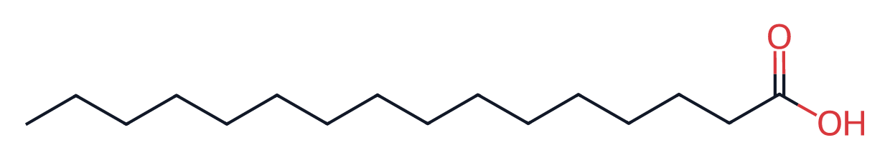

# 化学结构式 · dsh-chem-structures

> 让 DSH 在**回答正文**里直接画出分子结构式和反应方程式。你说「画一下布洛芬」，回答里就出现结构图，而不是躺在工具日志里。



## 这个插件能做什么

- **画分子结构式**：任意分子，输入 SMILES 即可，支持立体化学（楔形键/虚线键）、电荷、同位素、芳香环。
- **画完整反应方程式**：反应物 + 加号 + 箭头（上方可写催化剂/温度等条件）+ 产物，所有分子键长统一，排版整齐。
- **直接出现在正文里**：图由插件生成后插入回答正文，阅读连贯；工具调用在对话里只占一行摘要。
- **尺寸可调**：小 / 中 / 大三档，最大不超过阅读区的 640×360，点击图片可放大看原图。
- **完全离线**：内置 RDKit WebAssembly，不联网、不上传任何数据，断网也能画。

两张反应方程式示例：





## 系统要求

- DSH 桌面端（本项目在 Windows 桌面端开发并验证）。
- 一个「可管理插件」的 profile —— DSH 默认的桌面 profile 就是。

## 安装

三种方式任选一种。**装完如果提示「请重启 DSH」，重启一次即可**，之后不用再重启。

### 方式一：从 GitHub 安装（插件发布后推荐）

1. 打开 DSH，左侧边栏点「**插件**」。
2. 右上角「**添加插件**」→ 选「**安装第三方插件**」。
3. 在「包名或地址」里粘贴仓库地址：

   ```
   https://github.com/你的用户名/dsh-chem-structures
   ```

4. 点「**安装**」，等待完成提示。
5. 在「插件 → 已安装」里能看到「**化学结构式**」即成功。

> 访问 GitHub 慢或失败时，安装界面里可以切换「安装源」到国内镜像再试。

### 方式二：从本地目录安装（不联网也能装）

1. 打开仓库页面，点「**Code → Download ZIP**」，解压到一个**长期保留**的文件夹，例如：

   ```
   D:\DSH插件\dsh-chem-structures
   ```

2. 打开 DSH →「插件」→「添加插件」→「安装第三方插件」。
3. 在「包名或地址」里粘贴**解压后的文件夹路径**（不要选到上一层），例如 `D:\DSH插件\dsh-chem-structures`，点「安装」。
4. 如果提示重启，重启 DSH。

> ⚠️ 本地目录安装是「链接」方式：这个文件夹不能删除、不要改名，否则插件会失效。想搬家的话，卸载插件 → 移动文件夹 → 用新路径重装。

### 方式三：让 DSH 里的 AI 帮你装

把解压后的文件夹路径发给 AI，说：

```
把 D:\DSH插件\dsh-chem-structures 这个本地插件装到当前 profile
```

AI 会调用插件管理器完成安装，并告诉你是否需要重启。

## 开始使用

装好后不需要任何设置，直接问就行：

- 「画一下布洛芬的结构式」
- 「维生素 C 的立体结构给我看看」
- 「把乙酸和乙醇的酯化反应方程式画出来」
- 「用结构式对比葡萄糖和果糖」

回答里会出现结构图，图后面继续讲化学。想调整排版，直接说：

- 「图小一点」/「用大图」—— 对应 `size` 参数（`s` / `m` / `l`）
- 「方程式单独放一行」「两个分子并排对比」
- 「这次别画图，只讲文字」

## 工具参数（给好奇的人）

插件给 AI 提供两个工具：

| 工具 | 作用 | 参数 |
| --- | --- | --- |
| `draw_structure` | 画**一个**分子 | `smiles`（必填）、`caption`（图注/名称）、`size`（`s`/`m`/`l`） |
| `draw_reaction` | 画**一条**反应方程式 | `equation`（必填）、`conditions`（箭头上方文字）、`caption` |

`equation` 的写法是 `反应物>>产物`，同侧的多个组分用 `.` 分隔，例如：

```
CC(=O)O.OCC>>CC(=O)OCC.O      乙酸 + 乙醇 → 乙酸乙酯 + 水
```

### 图片大小

`size` 分 `s` / `m` / `l` 三档（约 300 / 440 / 620 像素宽），同一张图的效果差距很明显：





渲染时还会受阅读区 640×360 的上限约束，所以再大也不会撑破排版；点击图片可以在灯箱里看原图。

`conditions` 直接写化学条件，支持上下标字符，例如：`H₂SO₄, Δ`、`H⁺, −H₂O`、`NaBH₄, 0 ℃`。

## 图片存在哪里

- 每次画图会在**当前会话的工作区**下创建 `chem-drawings/` 目录，图片存为 `.svg`。
- 文件名由图片内容哈希生成：同一张图反复画，只会有一份文件，不会越攒越多。
- 想清理：直接删掉 `chem-drawings/` 目录即可，不影响插件运行。
- 换工作区：图片跟着当前工作区走，A 工作区的图不会跑到 B 工作区。

## 更新与卸载

- **更新**：DSH 的插件机制要求「先卸载再安装新版」。在「插件」里卸载，然后按上面步骤重新安装。
- **卸载**：插件卡片右上角「卸载」。
- 卸载后已经生成的图片仍留在工作区，可按需删除。

## 常见问题

**Q：回答里没有图，只有 `` 这样的文字？**

A：通常是这三种情况之一：① 图片文件被删除了（重新让它画一次）；② 工作区路径包含特殊字符；③ 当前不是桌面端/网页界面（例如 IM 机器人聊天窗口不渲染 Markdown 图片）。

**Q：安装时提示「请重启 DSH」？**

A：正常现象，重启一次即可。之后插件改动一般能热更新。

**Q：插件卡片显示「异常」？**

A：多半是插件目录被移动/删除（本地安装是链接方式）。卸载后按原路径重新安装即可。

**Q：会不会联网、上传我的数据？**

A：不会。结构渲染用的 RDKit WebAssembly 打包在 `vendor/` 里，全程本机运行；图片也只写在本地工作区。

**Q：为什么图上没有标出碳和氢？**

A：这是有机化学结构式的标准画法（骨架式）：顶点和折点默认是碳，碳上的氢省略，只有杂原子（O、N、S、卤素等）和它们连接的 H 才标出来。

## 工作原理（简版）

1. 插件在 DSH 里注册两个工具，并注入一段提示，告诉模型「涉及具体分子时要用工具画图，并把图放进回答正文」。
2. 调用工具时，Host 侧用内置的 RDKit 把 SMILES 渲染成 SVG：
   - 去掉 RDKit 默认的白色底板，按实际绘制范围收紧画布；
   - 把黑色键线改成固定深色、重映射杂原子配色；
   - 画反应式时，把每个分子单独渲染，再按统一键长横向拼装，自动插入加号和箭头。
3. SVG 写进工作区 `chem-drawings/`，工具把一行 Markdown 图片语法返回给模型。
4. 模型把这行贴进回答正文；DSH 的正文渲染器通过 `api/file` 路由读取本地图片并显示。

## 目录结构

```
dsh-chem-structures/
├─ package.json        # 插件清单：bundle 补丁 + Client 入口
├─ cordis.patch.yml    # 在 profile 里插入插件行
├─ index.js            # Host：两个工具 + 系统提示段
├─ render.cjs          # SMILES → SVG、反应式拼装、文件写入
├─ client.js           # Client：工具调用的紧凑行
├─ locale/             # 插件管理界面里的中文/英文名称与描述
├─ icon.svg            # 插件图标
├─ docs/               # README 预览图
├─ vendor/             # 内置 RDKit WebAssembly（含许可证）
├─ LICENSE             # MIT
└─ README.md
```

## 许可与致谢

- 插件代码采用 **MIT** 许可，见 [LICENSE](LICENSE)。
- 内置的 RDKit WebAssembly 采用 **BSD-3-Clause**，版权与完整条款见 [vendor/RDKit-LICENSE.txt](vendor/RDKit-LICENSE.txt)。
- [RDKit](https://www.rdkit.org/) —— 开源化学信息学工具包，本插件的全部绘制能力来自它。
- [SMILES](https://en.wikipedia.org/wiki/SMILES) —— 分子结构的一种文本表示法。

## 免责声明

本项目仅供学习与交流。化学结构由 RDKit 依 SMILES 自动绘制，重要用途请自行核对。
